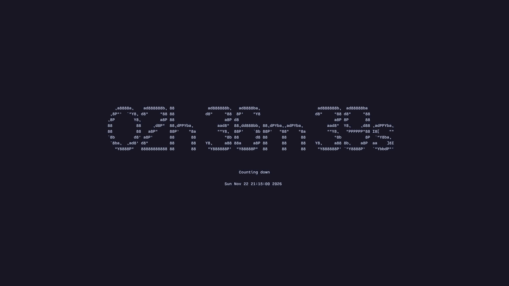

<h2 align="center">
C countdown/stopwatch program  
</h2>

Features:
- Option to keep going and start counting up after countdown expires
- Run a command when the countdown expires
- ASCII art timer using [figlet](https://www.figlet.org/)
- Show target date underneath timer
